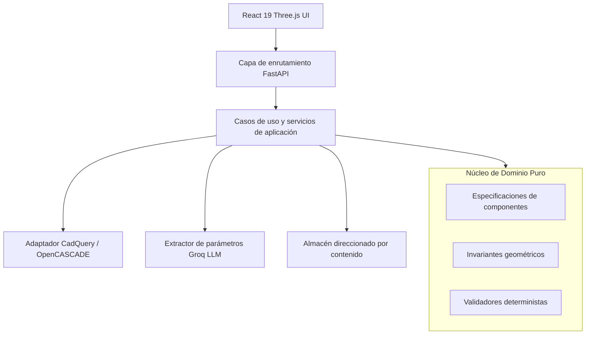

<picture>
  <source media="(prefers-color-scheme: dark)" srcset="docs/assets/banner-dark.svg">
  <source media="(prefers-color-scheme: light)" srcset="docs/assets/banner-light.svg">
  
</picture>

# ParametriCAD AI

<div align="center">

[](README.md)
[](#)
[](https://parametricad.naindev.com/)
[](https://github.com/Nain9Dev/parametricad-ai/actions/workflows/ci.yml)
[](https://status.naindev.com)
[](https://github.com/Nain9Dev/engineering-handbook)
[](https://codespaces.new/Nain9Dev/parametricad-ai)
[](https://react.dev/)
[](https://www.typescriptlang.org/)
[](frontend/src)
[](https://github.com/Nain9Dev/engineering-handbook/blob/main/governance/zero-cost-philosophy.md)

</div>

Motor de generación CAD paramétrico determinista con validación topológica de mallas aislada en el dominio y visor web 3D interactivo.

ParametriCAD AI construye sólidos B-Rep exactos con OpenCASCADE, los tesela en mallas poligonales, somete la geometría a verificaciones deterministas de calidad (hermeticidad, variedades 2-manifold, coherencia de normales hacia el exterior, cero auto-intersecciones) y publica artefactos identificados por contenido (SHA-256) en cinco formatos de ingeniería. Las especificaciones se proporcionan mediante controles basados en esquemas o se extraen de lenguaje natural.

## Despliegue en vivo

- **Aplicación web:** [parametricad.naindev.com](https://parametricad.naindev.com)
- **Backend API:** `https://parametricad-ai.onrender.com`

Ejemplo de prompt:
> *pipe, diameter 25.5mm, wall 2mm, length 200mm*

### Instalación como aplicación PWA

El cliente web es una Progressive Web App instalable. En Android, abre [parametricad.naindev.com](https://parametricad.naindev.com) en Chrome y pulsa en **Instalar aplicación**. En iOS, utiliza Compartir y luego **Añadir a pantalla de inicio**.

Funciona sin conexión mostrando las cuatro piezas precargadas (brida, codo, tubo y placa). El diseño es adaptativo desde móvil en cualquier orientación hasta ventana de escritorio.

---

## Desarrollo dirigido por especificaciones (SDD)

Este repositorio sigue una rigurosa metodología SDD. Cada decisión arquitectónica, modelo de datos y requisito funcional se especifica formalmente antes de su implementación:

| Fase del ciclo de vida | Documento de especificación | Descripción |
|---|---|---|
| **01 Charter** | [`docs/01-charter.md`](docs/01-charter.md) | Misión, propuesta de valor y límites de alcance |
| **02 Requirements** | [`docs/02-requirements.md`](docs/02-requirements.md) | Requisitos funcionales y no funcionales en sintaxis EARS |
| **03 Open Questions** | [`docs/03-open-questions.md`](docs/03-open-questions.md) | Registro de investigaciones técnicas y extensiones |
| **04 Architecture** | [`docs/04-architecture.md`](docs/04-architecture.md) | Arquitectura hexagonal y diagramas de flujo |
| **05 Data Model** | [`docs/05-data-model.md`](docs/05-data-model.md) | Modelos Pydantic de dominio y diagrama Mermaid ER |
| **06 Decisions** | [`docs/06-decisions/`](docs/06-decisions/) | Registros de decisiones de arquitectura (ADR-0001 a ADR-0008) |
| **07 Tasks** | [`docs/07-tasks.md`](docs/07-tasks.md) | Registro granular de tareas con etiquetas (`[A]`, `[M]`, `[H]`) |
| **08 Blockers** | [`docs/08-blockers.md`](docs/08-blockers.md) | Riesgos de dependencias externas |
| **09 Traceability** | [`docs/09-traceability.md`](docs/09-traceability.md) | Matriz bidireccional de requisitos a pruebas |
| **10 Runbook** | [`docs/10-runbook.md`](docs/10-runbook.md) | Entorno local, contenedores y operaciones de despliegue |

---

## Arquitectura

El sistema implementa una estricta Arquitectura Hexagonal (Puertos y Adaptadores). El núcleo de dominio geométrico carece por completo de dependencias HTTP, persistencia o kernels CAD externos.

```
backend/app/
  domain/          Núcleo geométrico puro: sin I/O, sin acoplamiento a kernel, sin estado
    geometry/      Algoritmos de malla (topología, auto-intersección, volumen, normales)
    models/        Especificaciones Pydantic, artefactos, resultados de validación
    ports/         Protocolos abstractos implementados por adaptadores de infraestructura
    errors.py      Jerarquía de excepciones de dominio con códigos legibles por máquina
  application/     Orquestación de pipelines, casos de uso y catálogo de capacidades
  infrastructure/  Adaptadores externos: CadQuery/OpenCASCADE, Trimesh, Groq, Filesystem, FastAPI
```



---

## Verificación

```bash
# Backend (259 pruebas)
pytest

# Frontend (208 pruebas)
npm test
```

---

**Autor**: Aitor Nain Mendoza Vallejo  
**Estándares**: [NainDev Engineering Handbook](https://github.com/Nain9Dev/engineering-handbook)
