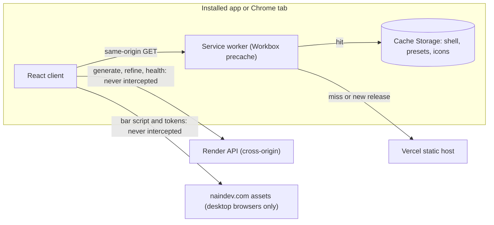
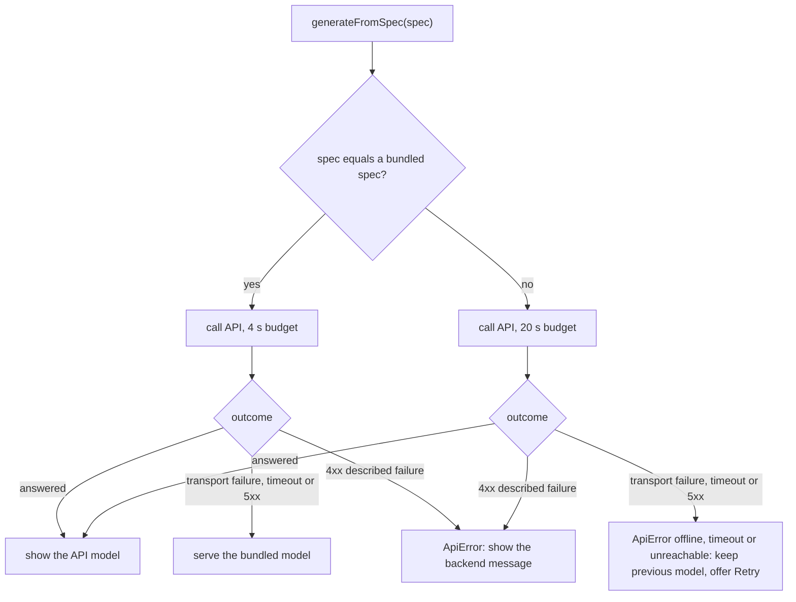

# Plan 001: Installable mobile app

Design for `spec.md`. Decisions are recorded in ADR-0007 (delivery) and ADR-0008 (fallback). Nothing here touches the backend.

## 1. Delivery architecture

## 2. Generation fallback (ADR-0008)

`generateFromPrompt` follows the same shape with "normalised prompt equals the showcase prompt" as the match test. `refineModel` has no bundled answer, so a transport failure becomes the same `offline` or `network_unreachable` error.

New module `src/lib/bundledPresets.ts` holds `specsEqual` (same keys and values, order ignored), `bundledKindForSpec` and `bundledKindForPrompt`. `apiClient.ts` classifies a failure as bundled-eligible (status 0, client timeout, status 500 or above) or described (a 4xx with the error envelope). A client timeout is converted to `ApiError('generation_timeout')` before it leaves the module, because `useGeneration` ignores `AbortError` and would leave the spinner running.

`presets.ts` is corrected so the elbow and plate specs equal the bundled specs (`outer_diameter_mm` 25, `wall_thickness_mm` 2.5, `bend_radius_mm` 50, `bend_angle_deg` 90, `leg_length_mm` 20; `width_mm` 120, `depth_mm` 80, `thickness_mm` 10, `corner_radius_mm` 8, `center_hole_diameter_mm` 20) and the subtitles state those values.

## 3. Progressive Web App

**Manifest** (`frontend/public/manifest.webmanifest`, static): `id` and `scope` `/`, `start_url` `/`, `name` "ParametriCAD AI", `short_name` "ParametriCAD", `display` `standalone`, `orientation` `any`, `background_color` and `theme_color` `#08090b` (the existing `--color-void` and `theme-color` meta), `categories` productivity and utilities, and three icons: 192 and 512 with purpose `any`, plus a separate 512 with purpose `maskable`.

**Icons** (`frontend/public/icons/`): `icon-192.png`, `icon-512.png`, `icon-maskable-512.png`, `apple-touch-icon.png` (180). `frontend/scripts/generate-pwa-icons.py` draws the existing cube mark from `favicon.svg` with Pillow at 4x supersampling and writes them. The outputs are committed, so CI needs no Python. The `any` icons keep the rounded dark tile; the maskable and Apple icons are full bleed with the mark inside the central 70 %.

**Head tags** (`index.html`): manifest link, apple-touch-icon, `mobile-web-app-capable`, `apple-mobile-web-app-capable`, `apple-mobile-web-app-title`, `apple-mobile-web-app-status-bar-style` set to `black`, and the viewport `width=device-width, initial-scale=1.0, viewport-fit=cover, interactive-widget=resizes-content`. Never `user-scalable=no` or `maximum-scale`. The `tokens.css` link gains `media="(min-width: 640px)"` so a phone does not block first paint on a third-party stylesheet it does not use.

**Service worker** (`frontend/pwa.config.ts`, read by `vite.config.ts` and by a test):

- `strategies: 'generateSW'`, `registerType: 'prompt'`, `injectRegister: false`, `manifest: false`, `devOptions.enabled: false`, `selfDestroying: false`.
- Workbox: `globPatterns` for `**/*.{js,css,html,svg,png,webmanifest}` and `presets/*.{json,glb}`; `globIgnores` for `og-image.png`, `robots.txt`, `sitemap.xml`; `navigateFallback: '/index.html'`; `navigateFallbackDenylist` for `/api/`, `/static/`, `/health`; `cleanupOutdatedCaches: true`; `clientsClaim: true`; `runtimeCaching: []`.
- Registration through `useRegisterSW` from `virtual:pwa-register/react`, wrapped in `usePwaUpdate`. Vitest aliases that module to a stub.

**Install control** (`useInstallPrompt`): listens for `beforeinstallprompt` (stores the event, calls `preventDefault`) and `appinstalled`; exposes `canInstall`, `promptInstall()` and `showIosHint` (iOS Safari, not standalone). After `prompt()` the stored event is dropped, since it cannot be reused. `isStandalone` reads `matchMedia('(display-mode: standalone)')` and iOS `navigator.standalone`.

**Offline state** (`useOnlineStatus`): `navigator.onLine` plus `online` and `offline` events. The header shows an Offline badge in place of the health badge while it is false.

**Update notices** (`PwaStatus`): an Update banner with Reload and Later when `needRefresh` is true, and a one-time "Ready to work offline" status when `offlineReady` is true. Both use `role="status"`.

**Headers** (`vercel.json`): `Cache-Control: no-cache` for `/sw.js` and `/manifest.webmanifest`, `Content-Type: application/manifest+json` for the manifest. The CSP is untouched.

**Build check** (`frontend/scripts/verify-pwa-build.mjs`, run as `npm run verify:pwa` after `npm run build`): `dist/manifest.webmanifest` and `dist/sw.js` exist; the precache list contains `index.html`, `manifest.webmanifest`, `presets/catalog.json`, the four presets (JSON and GLB) and the icons; it contains no API origin and no `/api/`; the summed size of the listed files is at most 3 MB.

## 4. Compact workspace

One DOM tree, restyled by breakpoint. The canvas is never unmounted, so rotating the phone keeps the camera.

| Context | Condition | Layout |
|---|---|---|
| Wide | width of 1 024 px or more | Existing three columns, unchanged |
| Compact portrait | below 1 024 px | Viewer, tab bar, panel in one column |
| Compact landscape | below 1 024 px and `orientation: landscape` and height of 34 rem or less (custom Tailwind variant `short-landscape`) | Viewer left, tab bar and panel right (18 to 24 rem) |

The workspace grid uses named areas: `viewer`, `tabs`, `panel` when compact, `inputs viewer report` when wide. Both existing asides sit in the `panel` area when compact and the inactive one is hidden, so the form keeps its state.

**Compact portrait budget** at 375 x 812: header 48 px, viewer pane `minmax(16rem, 46dvh)` (374 px, of which 44 px is the toolbar strip), tab bar 48 px plus the bottom safe area, panel takes the rest and scrolls on its own with `overscroll-behavior: contain`. The shell is `h-dvh overflow-hidden`, so the page never scrolls.

**Tabs** (`WorkspaceTabs`): Presets, Parameters, Describe, Report. ARIA tabs with roving tabindex, Left, Right, Home and End keys, `aria-controls`. Tab panel roles are applied only while compact, using `useMediaQuery('(max-width: 1023.98px)')`. Parameters and Describe also set the existing `mode` state; the Prompt showcase card switches to Describe. The first tab is Presets. The Report tab carries a status dot from `model.quality.status`, or the invalid tone while `generation.error` is set.

**Viewer toolbar when compact** (`ViewerToolbarCompact`): one 44 px strip with the four orientation presets, Fit and a View button. View opens `ViewOptionsSheet` (a native `<dialog>` styled as a bottom sheet: modal focus handling, Escape and backdrop to close) holding shading, the seven toggles with labels, the section controls, the caliper hint and the projection switch. The existing `ViewerToolbar` is split into reusable controls (`ShadingControl`, `ViewToggles`, `SectionControls`, `OrientationPresets`, `ProjectionControl`) so the wide toolbar and the sheet share one implementation.

**Generation notice** (`ViewerNotice`): while compact and `generation.error` is set, a `role="alert"` strip over the viewer shows the message and Retry, because the full error lives in the Report tab. Wide layouts keep the current Report-column error.

**Header**: 48 px tall when compact; the tagline hides below 640 px; the health badge reduces to its dot below 640 px; Save project and Open project move into a small overflow menu below 640 px (they are hidden there today). The Install control and the Offline badge sit in the same cluster.

**Touch targets**: `pointer-coarse:` variants on `Button`, `ToggleButton`, `SegmentedControl`, `SelectField`, `ComponentPicker`, `ShowcaseBar` tiles, the checkbox row, the section slider and the camera presets: 44 px minimum. `NumberField` becomes `[-] [value] [+]` with 44 px buttons on coarse pointers. Text inputs, selects and the prompt textarea use 16 px text on coarse pointers so iOS does not zoom on focus.

**Safe areas and overscroll**: `viewport-fit=cover`; the shell pads left and right with `env(safe-area-inset-*)`, the tab bar pads the bottom, the header pads the top. `html, body` get `overscroll-behavior: none` so a drag on the model cannot trigger pull to refresh; interactive controls get `touch-action: manipulation`. The canvas keeps the `touch-action: none` that `OrbitControls` sets.

**Ecosystem bar**: `:root { --ecosystem-bar-height: 38px }`, forced to `0px` with `nain-ecosystem-bar { display: none }` under `(max-width: 39.9375rem), (display-mode: standalone), (display-mode: minimal-ui), (display-mode: fullscreen)`. The shell pads its top by that variable, so the bar stops covering the header on desktop. The 38 px is the height of the pinned script version (`ecosystem-bar.js?v=2.1.0`).

## 5. Files

| Area | New | Changed |
|---|---|---|
| Fallback | `src/lib/bundledPresets.ts` | `src/lib/apiClient.ts`, `src/lib/presets.ts` |
| PWA | `public/manifest.webmanifest`, `public/icons/*`, `pwa.config.ts`, `scripts/generate-pwa-icons.py`, `scripts/verify-pwa-build.mjs`, `src/lib/hooks/useInstallPrompt.ts`, `useOnlineStatus.ts`, `usePwaUpdate.ts`, `src/components/layout/InstallButton.tsx`, `OfflineBadge.tsx`, `PwaStatus.tsx` | `index.html`, `vite.config.ts`, `vitest.config.ts`, `package.json`, `package-lock.json`, `tsconfig.app.json`, `vercel.json`, `.github/workflows/ci.yml` |
| Layout | `src/lib/hooks/useMediaQuery.ts`, `src/components/layout/WorkspaceTabs.tsx`, `HeaderMenu.tsx`, `src/components/ui/BottomSheet.tsx`, `src/components/viewer/ViewerControls.tsx`, `ViewerToolbarCompact.tsx`, `ViewOptionsSheet.tsx`, `ViewerNotice.tsx` | `src/App.tsx`, `src/index.css`, `AppHeader.tsx`, `ViewerToolbar.tsx`, `ShowcaseBar.tsx`, `ComponentPicker.tsx`, and the `ui/` primitives named above |
| Docs | `docs/06-decisions/ADR-0007`, `ADR-0008` (written) | `docs/02-requirements.md` (written), `03-open-questions.md`, `04-architecture.md`, `07-tasks.md`, `08-blockers.md`, `09-traceability.md`, `10-runbook.md`, `README.md`, `frontend/README.md` |

## 6. Test plan

Each test file carries `// @req REQ-...` like the existing ones.

| Requirement | Automated | Manual |
|---|---|---|
| REQ-UBI-10 | `src/test/manifest.test.ts` (members, icon files, PNG sizes read from the header, colour parity with `index.html` and `--color-void`), `src/test/indexHtml.test.ts` | Chrome offers Install app |
| REQ-UBI-11 | `src/test/pwaConfig.test.ts`, `npm run verify:pwa` in CI | Offline reload against the preview build |
| REQ-UBI-12 | `WorkspaceTabs.test.tsx`, `useMediaQuery.test.ts` | Viewport matrix below |
| REQ-UBI-13 | `src/test/touchTargets.test.tsx` (class contract), `indexHtml.test.ts` (viewport tag) | DOM audit at 375 x 812 reports zero targets under 44 px |
| REQ-UBI-14 | `src/test/ecosystemBar.test.ts` (CSS contract) | Header visible at 1 280 px, bar hidden at 375 px and when installed |
| REQ-UBI-15 | `src/lib/presets.test.ts` (each showcase spec equals `public/presets/<id>.json`) | |
| REQ-EVT-06 | `useInstallPrompt.test.tsx`, `InstallButton.test.tsx` | Install from the header on the phone |
| REQ-EVT-07 | `PwaStatus.test.tsx` | Rebuild, reopen, banner appears |
| REQ-STA-04 | `useOnlineStatus.test.tsx`, `OfflineBadge.test.tsx` | Airplane mode on the phone |
| REQ-UNW-04, REQ-UNW-05 | `src/lib/apiClient.fallback.test.ts`, `src/lib/bundledPresets.test.ts` | Backend stopped, edit a parameter |
| REQ-DEP-06 | `src/test/vercelConfig.test.ts` (extended) | `curl -sI` on the deployment |

Order: tests first for every task (red, then green). `npm test` is added to CI, since it does not run there today.

## 7. Verification

**Viewport matrix** (Browser pane emulation, against `npm run dev` for layout and `npm run preview` for the worker): 360 x 640, 375 x 812, 412 x 915, 768 x 1 024, 812 x 375, 1 024 x 768, 1 440 x 900. At each: no horizontal overflow, the viewer fully visible, the header not covered, console free of errors, and on the compact sizes a DOM audit of target sizes. Screenshots go to the scratchpad, not the repository.

**Offline start**: build, serve the preview, load once, check `navigator.serviceWorker.controller` and the cache keys, stop the preview server, reload; the shell and a bundled part must appear.

**Device checklist** (TSK-33, done by the user): install from the three-dot menu; the icon is not clipped; the app opens without browser chrome with the dark splash; rotate; orbit, pinch and pan the model; edit a parameter with the keyboard open and confirm the viewer stays visible (A2); airplane-mode launch shows the shell, the flange and the Offline badge; offline custom edit shows the connection notice; reconnect and Retry works; redeploy and confirm the Update banner; uninstall and reinstall.

## 8. Rollout and rollback

1. Merge to `main`; Vercel deploys production (`parametricad.naindev.com`).
2. `curl -sI` the site, `/sw.js` and `/manifest.webmanifest` for the headers.
3. Run the device checklist against production.
4. Rollback: Vercel Instant Rollback or a revert. If a bad worker reached clients, set `selfDestroying: true` in `pwa.config.ts` and deploy: the generated worker unregisters itself and deletes every cache. Documented in `docs/10-runbook.md`.
