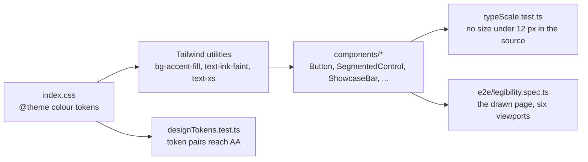

# Plan: Visual architecture, first slice

Spec: `spec.md`. Requirements: REQ-UBI-16, REQ-UBI-17, REQ-UBI-18.

## 1. Where the rules live

The look of the interface comes from three places, and each gets one guard so that a later change cannot undo this one quietly.



The unit tests are cheap and catch a token or a class that moves. The browser spec measures what is actually drawn, which is the only place a colour used on a surface it was not designed for shows up.

## 2. Tokens (D1)

| Token | Before | After | Contrast |
|---|---|---|---|
| `--color-ink-faint` | `#6b7688` | `#808b9b` | 3.47 to 4.34 before; 4.62 or more after, on all four surfaces |
| `--color-accent-fill` (new) | none: `accent` was used as a fill | `#086bfc` | white on it: 3.33 before, 4.65 after |
| `--color-accent-fill-hover` (new) | `accent-hover` `#5b9dff`, which is lighter and so worse | `#035adb` | white on it: 6.02 |
| `--color-accent`, `--color-accent-hover` | unchanged | unchanged | stay for text, borders, tints and focus rings |

Filled controls move from `bg-accent` to `bg-accent-fill`: `Button` (primary), `SegmentedControl` (active segment) and the badge of the active showcase card. Every other use of `bg-accent` is a tint or a bar without text and stays.

## 3. Type floor (D2)

`text-[0.5625rem]` (9 px), `text-[0.625rem]` (10 px) and `text-[0.6875rem]` (11 px), 54 uses in 18 files, become `text-xs` (12 px). The browser spec's overflow and touch audits show which controls stop fitting; each of those is restructured (a shorter label, a wrap, an icon-only form below a width) rather than set back to a smaller size. The review of screenshots at 1 024 px found three more places that read badly at 12 px, all fixed by letting text wrap instead of break or clip: the Euler-Poincaré box and the action row of the mesh validation card keep each value whole and wrap between them, and the metric labels, the C1 to C10 titles and the artifact descriptions wrap instead of ending in an ellipsis.

## 4. Showcase cards (D3)

```
[icon]  Title            [BADGE]
        Subtitle in full, wrapping if it must
```

- The card is a button of full width in its grid cell; the text block has `min-w-0` and wraps.
- The title row is `flex flex-wrap`: the badge follows the title and drops under it when the line is short.
- No `line-clamp`, no `truncate`.
- The grid is one column and becomes two where its container is 28 rem or wider (a Tailwind container query), so the 20 rem desktop column and a phone show one column and a tablet panel shows two.

## 5. Guards

| Guard | Proves |
|---|---|
| `src/test/designTokens.test.ts` | each text token reaches 4.5:1 over each of the four surfaces; the accent ink reaches it over the accent fill and its hover; no class puts white text on the plain accent |
| `src/test/typeScale.test.ts` | no arbitrary text size under 12 px remains in the source |
| `e2e/legibility.spec.ts` | at the six viewports of spec 001, in every tab, in the Description mode and in the View sheet: no text under 12 px, none under AA contrast, no showcase card with clipped or overlapping content |

## 6. Rollout and rollback

Ships with a normal release. Rollback is a revert: the tokens and the classes are the whole change.
