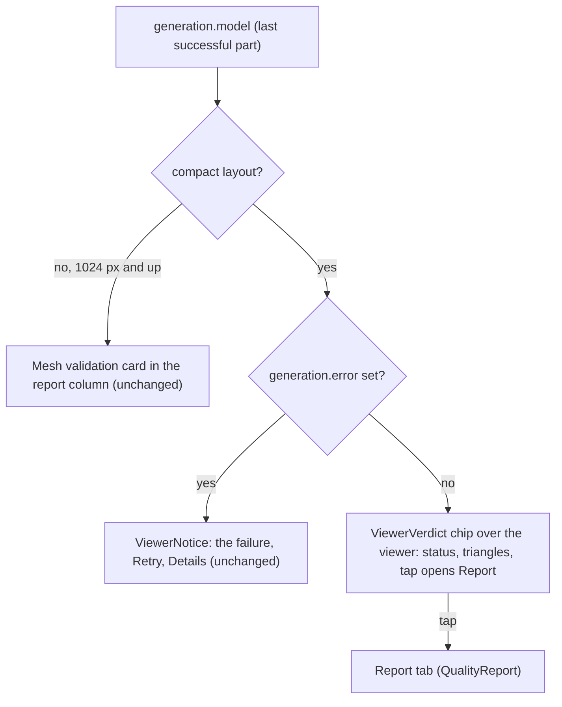

# Plan next: the validation verdict in the first view

Design for `spec.md`. Nothing here touches the backend, the bundled models or the opening part.

## 1. Where the verdict is drawn



The chip is an overlay like `ViewerNotice`, but anchored to the lower left corner of the viewer: the top is taken by the "Generating geometry" pill (centred, and wide enough to overlap a top-left chip at 320 px) and by the error strip, and the lower right by the gizmo. The overlay wrapper ignores pointer events; only the chip itself takes them, so the canvas behind it still orbits.

## 2. The component

`frontend/src/components/viewer/ViewerVerdict.tsx`:

- Props: `report: MeshQualityReport`, `onDetails: () => void`.
- A `<button type="button">` whose accessible name is its text: the status word (Valid, Degraded, Invalid), then the triangle count (`formatCount`). The status word takes the tone of `QualityReport` (`text-valid`, `text-warn`, `text-invalid`) with the matching icon; the rest is `text-ink-muted`. `title` says "Open the mesh validation report".
- Sizes: `text-xs` (12 px, REQ-UBI-17), `h-8` with `pointer-coarse:h-11` (REQ-UBI-13), `bg-surface/95` with a `border-line` border and backdrop blur like the other pills, so the AA pairs of spec 002 hold (REQ-UBI-16).

## 3. Wiring in `App.tsx`

In `viewerPane`, next to the existing error overlay:

```tsx
{isCompact && !generation.error && model ? (
  <div className="pointer-events-none absolute inset-x-0 bottom-0 z-10 flex p-2">
    <ViewerVerdict report={model.quality} onDetails={() => selectTab('report')} />
  </div>
) : null}
```

`selectTab('report')` is the same path the tabs use, so the tab becomes selected and the panel scrolls on its own as today. The wide layout never renders the chip (`isCompact` is false), which keeps `layout.spec.ts`'s "nothing covers the viewer" true on both layouts: the chip never reaches the centre of the canvas.

## 4. Tests, written first

| Test | Checks |
|---|---|
| `src/components/viewer/ViewerVerdict.test.tsx` | the three statuses render their word and the count; the tone class follows the status; a click calls `onDetails`; the accessible name reads status and count |
| `src/App.test.tsx` (new `describe`) | on the compact layout the chip is inside `main` once the first part is in, clicking it selects the Report tab; on the wide layout the chip is absent; with a failed request the error strip is shown and the chip is not |
| `e2e/layout.spec.ts` (compact cases) | the chip is visible, inside the canvas, in its lower half and clear of its centre, and opens the Report tab; at least 44 px high with a touch screen on the 375 x 812 case through `touch.spec.ts`'s existing audit; the wide case asserts it is absent |

Tags: `// @req REQ-UBI-19` on each file, as the traceability matrix expects.

## 5. Verification

From `frontend/`: `npm run lint`, `npm run typecheck`, `npm run typecheck:e2e`, `npm test`, `npm run build`, `npm run verify:pwa`, `npm run test:e2e`. From `backend/`: `pytest` keeps the traceability gate green (the new requirement is `(frontend)`-scoped). Screenshots at 1 280 x 800, 375 x 812 and 320 x 568 before and after, kept outside the repository and attached to the pull request.
